<!-- mPaiva_ · Portfolio 2026 · todas as animações são SVG deste repositório (assets/profile) -->

  

  
  &nbsp;
  

 

  

  
  

  
  

  
    TAMBÉM NO AR &nbsp;·&nbsp;
    <a href="https://chromewebstore.google.com/detail/n%C3%A3o-seguidores-upaiva/pggbblnnnofafnnieccbdopeaaafolin?hl=pt-br">Não Seguidores</a> &nbsp;·&nbsp;
    <a href="https://chromewebstore.google.com/detail/instagrowth-ia-upaiva/eopaifcdlgkmmpemkpkdklhaddgllbkc?hl=pt-br">InstaGrowth IA</a> &nbsp;·&nbsp;
    <a href="https://chromewebstore.google.com/detail/calculadora-de-impostos-b/cifdfcomjlidngiddbdnhmcakecggehh">Calc Impostos BR</a>
    &nbsp;—&nbsp; extensões publicadas na Chrome Web Store
  

 

  

  

 

  

<!-- CODE_DASHBOARD:START -->

  

<!-- CODE_DASHBOARD:END -->

 

  

  
  &nbsp;
  
  &nbsp;
  

