<!-- mPaiva_ · Portfolio 2026 · todas as animações são SVG deste repositório (assets/profile) -->

  

  
  &nbsp;
  

 

  

  <a href="https://github.com/EoPaiva/win-toolkit"></a>

  

  Formatar não precisa custar o dia inteiro. Um <code>.exe</code> de 106 KB, sem runtime extra, que instala dependências, programas e drivers oficiais, analisa a segurança do PC e otimiza em quatro níveis que podem ser simulados antes de aplicar. Cada comando, PID, código de saída e tempo aparece no terminal embutido.

<b>O que tem dentro do win-toolkit</b>

 

- **Instalar:** 24 dependências estilo AIO, programas essenciais e um catálogo de 102 itens com perfis prontos (Completo, Básico, Gamer, Dev e IA). Até 4 instalações juntas, conforme CPU e RAM, com progresso ponderado e cancelamento que encerra os processos filhos.
- **Drivers:** catálogo oficial do Windows Update, backup do driver anterior antes de cada troca e botão para voltar.
- **Analisar:** varredura somente leitura de Defender, Firewall, UAC, Secure Boot, TPM, BitLocker, portas abertas e saúde dos discos.
- **Otimizar:** níveis Leve, Média, Alta e Altíssima, com mais de 170 ações, plano simulado, ponto de restauração e lista de serviços intocáveis.
- **Ferramentas:** preparar formatação, atualizar tudo, limpar disco, reparar com DISM e SFC e diagnóstico anti-crash para MTA:SA.
- **Terminal e Ctrl K:** a saída real de cada processo e uma paleta de comandos, como no [upaiva.dev](https://upaiva.dev).
- **O que ele se recusa a fazer:** desligar Defender, Firewall ou Windows Update, prometer FPS, usar banco de drivers de terceiros ou levar logins e tokens.

 

  

  

  Uma extensão do Chrome que organiza quem você segue. Lê as sugestões de três referências, segue só quem passa nas regras e para de seguir em fila, um perfil por vez, conferindo cada resultado no próprio perfil antes de avançar. Tudo fica no seu navegador.

<b>O que tem dentro do Instagram Fluxo</b>

 

- **Seguir sugestões:** três referências configuráveis, com alternativa pelos seguidores delas. Pula quem já segue você, contas já processadas e as próprias referências.
- **Parar de seguir todos:** fila com parada, histórico e conferência de confirmações atrasadas. Se o perfil ainda aparece como seguido, fica pendente e a fila continua.
- **Ritmo seguro:** intervalos e pausas configuráveis, cota local de tentativas e pausa automática diante de qualquer aviso de restrição.
- **Agente de IA opcional:** traga sua chave (BYOK) com fallback entre OpenAI, Claude, Gemini e OpenRouter. As chaves ficam num cofre local cifrado com AES-GCM.
- **Fila visível:** carrossel com miniaturas locais e cards expansíveis de sugestões e histórico.
- **Coletor para Windows:** native messaging em Python grava diagnósticos em JSONL com índice SQLite.

 

  

  <a href="https://azvlancamentos.com.br/"></a>
  <a href="https://upaiva.dev/"></a>

  
  <a href="https://studiojmarq.com/"></a>

  
    TAMBÉM NO AR &nbsp;·&nbsp;
    <a href="https://chromewebstore.google.com/detail/n%C3%A3o-seguidores-upaiva/pggbblnnnofafnnieccbdopeaaafolin?hl=pt-br">Não Seguidores</a> &nbsp;·&nbsp;
    <a href="https://chromewebstore.google.com/detail/instagrowth-ia-upaiva/eopaifcdlgkmmpemkpkdklhaddgllbkc?hl=pt-br">InstaGrowth IA</a> &nbsp;·&nbsp;
    <a href="https://chromewebstore.google.com/detail/calculadora-de-impostos-b/cifdfcomjlidngiddbdnhmcakecggehh">Calc Impostos BR</a>
    &nbsp;—&nbsp; extensões publicadas na Chrome Web Store
  

 

  

  

 

  

<!-- CODE_DASHBOARD:START -->

  

<!-- CODE_DASHBOARD:END -->

 

  

  
  &nbsp;
  
  &nbsp;
  

